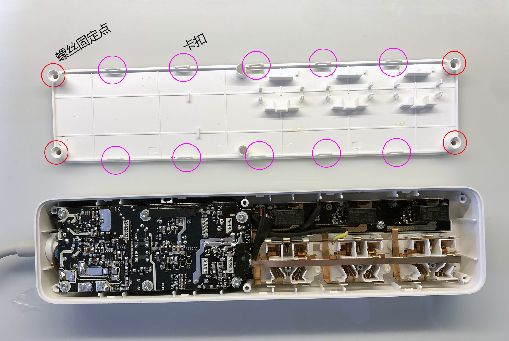
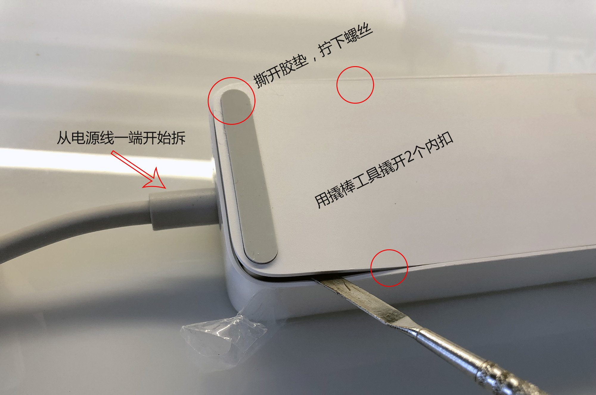
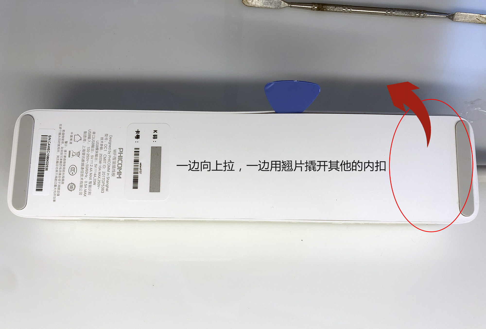
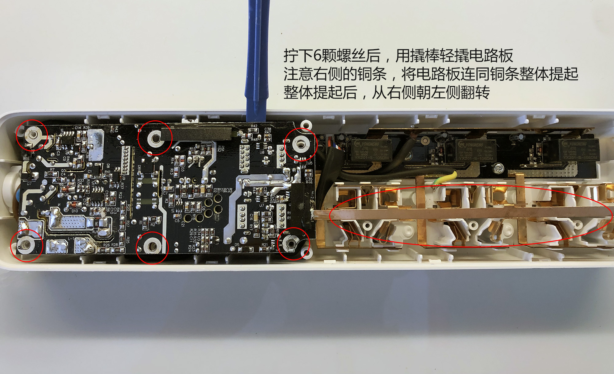
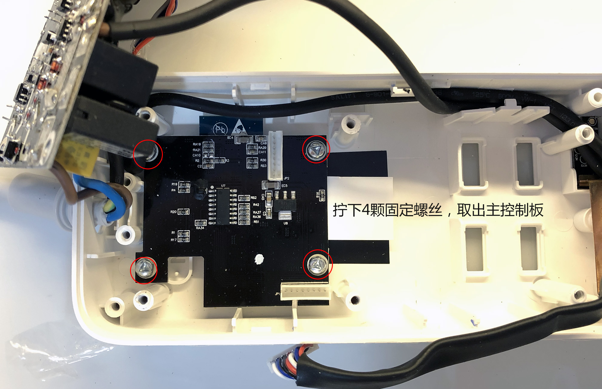
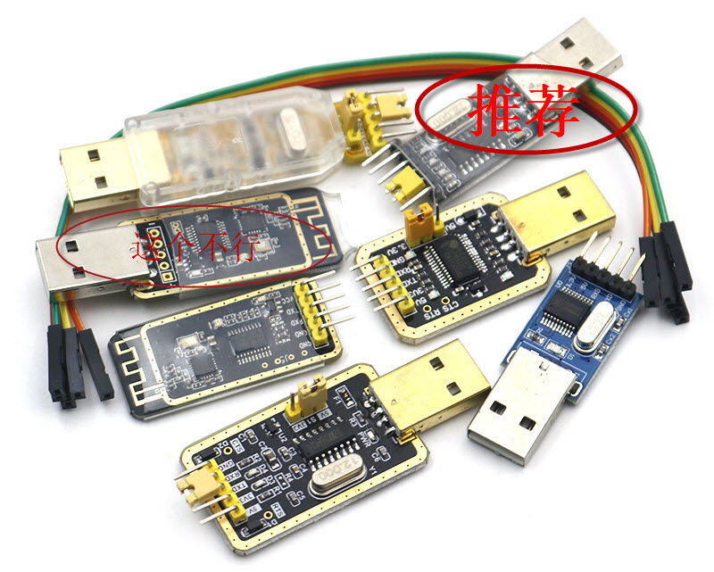
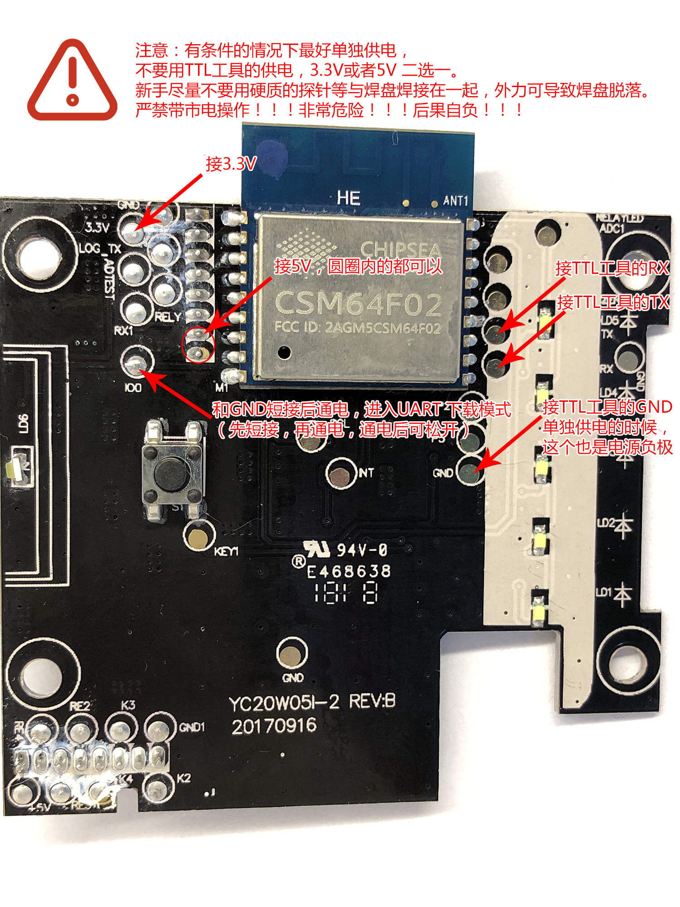
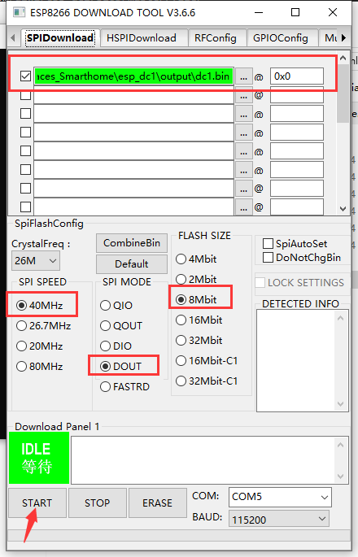

# 拆机接线与烧录

已有本项目固件时，可直接通过 WebUI 上传升级；首次安装需串口烧录。

## 拆机接线

 **全程断开市电。刚断电的电容仍可能带电，不要触摸电路板。**

准备拆机工具，按图取出主控板：

使用 USB 转 TTL 模块，TX/RX 交叉连接并共地。串口逻辑电平为 3.3 V，供电按板上标识及接线图连接。

## 串口烧录

下载乐鑫 [Flash Download Tools](https://www.espressif.com/zh-hans/support/download/other-tools) 和本项目 [Releases](https://github.com/pexcn/phicomm-dc1-firmware/releases) 中的 `firmware.bin`；本地编译可使用 `output/dc1.bin`。

1. 将 IO0 与 GND 短接，再通过接线图中的低压电源上电，进入下载模式。
2. 工具中选择 ESP8266、对应串口，写入地址设为 `0x00000`，Flash 容量为 1 MB（8 Mbit），模式为 DOUT。
3. 点击 START，等待出现 FINISH。
4. 断电，移除 IO0 与 GND 的短接，再上电启动。无网络配置时会开启配网热点，也可长按总开关键重新配网。

升级时只写应用固件，勿整片擦除或上传文件系统镜像，以保留配置和运行数据。从其他固件迁移前先备份，其 OTA 格式及存储布局兼容性未经验证。

## 图片来源

拆机、接线方法及图片来自[三木大神的 DC1 ESPHome 项目](https://github.com/Samuel-0-0/phicomm_dc1-esphome/tree/master/cookbook)，沿用原项目授权。
