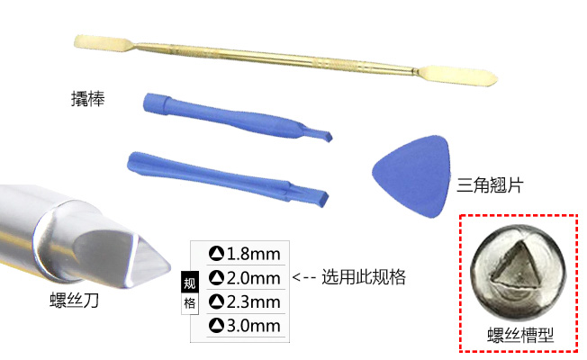
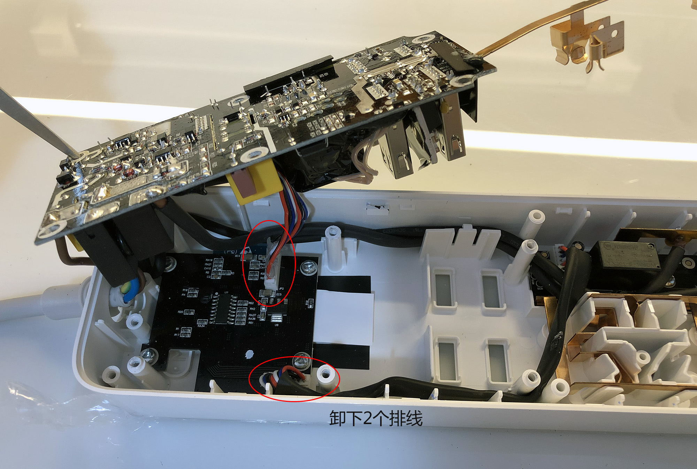
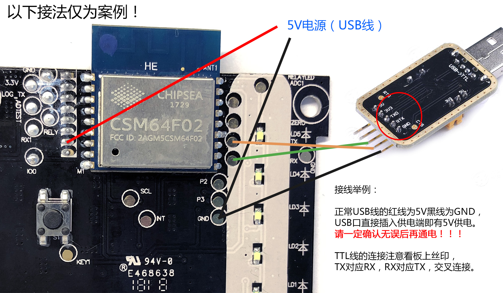

# 固件烧录

首次烧录需要拆解 DC1，通过 USB 转 TTL 模块连接电脑。已有本项目固件的设备可在 WebUI 的“系统维护 → 固件升级”上传应用固件。

## 拆机与 TTL 接线

> 本节拆机、接线方法及图片来自[三木大神的 DC1 ESPHome 项目](https://github.com/Samuel-0-0/phicomm_dc1-esphome/tree/master/cookbook)，感谢授权使用。

 **拆机、接线时必须断开市电。刚断电的电容仍可能带电，不要触摸电路板。**

### 拆下主控板

准备拆机工具：

按图拆开外壳并取出主控板：

### 主控板接线

准备 USB 转 TTL 模块：

按下图连接主控板。TX 与 RX 交叉连接，并连接 GND；电源接法以板上标识和接线图为准，串口逻辑电平使用 3.3 V。

## 通过串口烧录

### 下载工具和固件

- 工具：乐鑫 [Flash Download Tools](https://www.espressif.com/zh-hans/support/download/other-tools)。
- 固件：本项目 [Releases](https://github.com/pexcn/phicomm-dc1-firmware/releases) 中的 `firmware.bin`，或本地编译生成的 `output/dc1.bin`。

### 进入烧录模式

将主控板的 IO0 与 GND 短接后再上电，使 ESP8266 进入串口下载模式。插排保持与市电断开，仅使用接线图中的低压供电。

### 写入应用固件

打开 Flash Download Tools，选择 ESP8266，设置固件写入地址为 `0x00000`、Flash 容量为 1 MB（8 Mbit）、Flash 模式为 DOUT，并选择 USB 转 TTL 模块对应的串口。软件界面参考下图：

点击 START，等待出现完成提示：

完成后断开低压供电，移除 IO0 与 GND 的短接，再上电启动。首次启动进入配网模式；也可长按总开关键重新进入配网。

## 保留已有数据

升级本项目固件时，只写应用固件，不上传文件系统镜像，不执行整片 ERASE，以保留网络配置、电量和开关记忆。首次升级或存储异常时，再按 WebUI 的具体提示初始化或恢复对应记录。

从其他固件迁移前请备份原固件；本文不保证其他固件的 OTA 格式或存储布局兼容。
